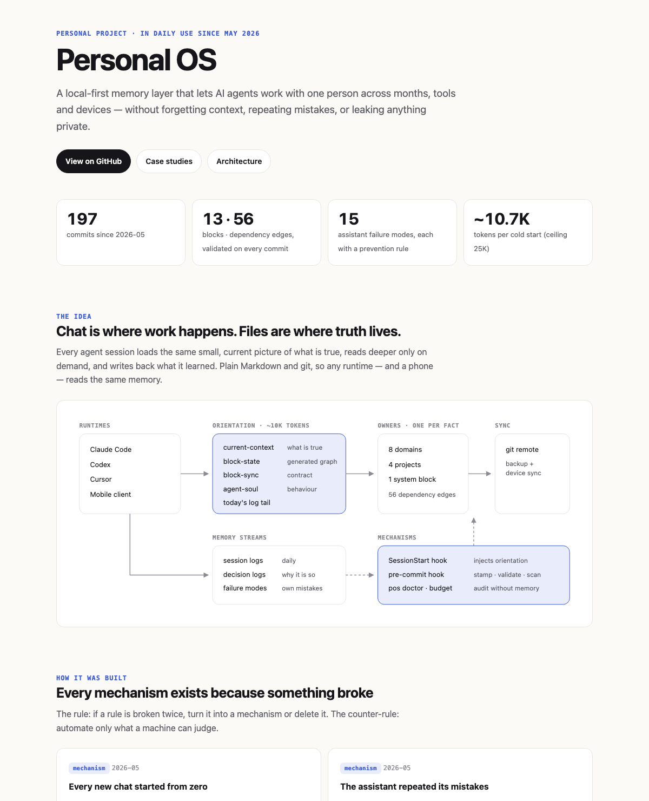
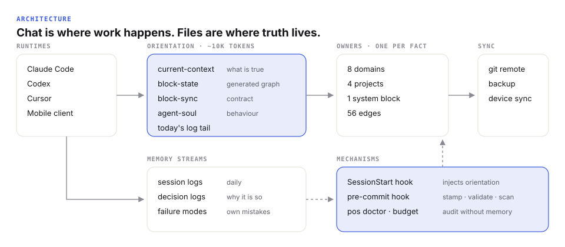
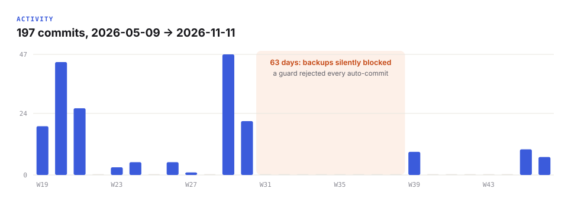
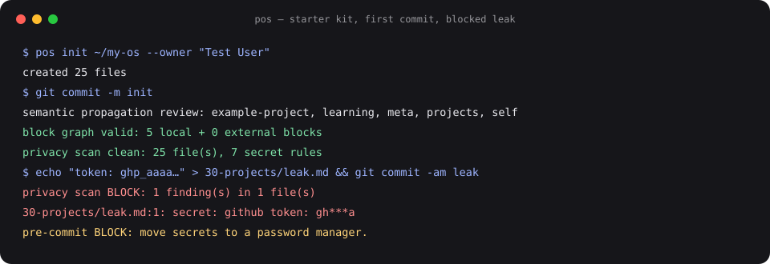

# Personal OS

**A local-first memory layer that lets AI agents work with one person across months, tools and devices — without forgetting context, repeating mistakes, or leaking anything private.**

Plain Markdown + git underneath, a small Python CLI (`pos`) on top. I have used it every day since May 2026 with three different agent runtimes and a phone. This repo is the public, generic version: the architecture, the tooling, a starter kit anyone can install, and the story of how each piece came to exist.

<p align="center"></p>

## In two minutes

- **Problem.** Every AI chat starts from zero. Context lives in your head, decisions get re-litigated, and the assistant makes the same mistake twice.
- **Approach.** One source of truth per fact, loaded into every session automatically; the assistant's own mistakes logged as data; anything broken twice turned into a mechanism.
- **Evidence.** 197 commits over six months · 13-block dependency graph validated on every commit · 10 decision logs · 15 catalogued assistant failure modes · cold start measured at ~10.7K tokens · 34 tests including end-to-end runs through real git hooks.
- **Judgment.** Some of the best decisions were *not* automating: no custom mobile bot when an existing client covered 90% for $0; no model in the loop where a script can decide.

<p align="center"></p>

## Problems → mechanisms

| Problem | Mechanism |
|---|---|
| Every new chat starts from zero | `SessionStart` hook injects current state, the block graph and today's log |
| The assistant repeats mistakes | Failure-mode catalog with triggers and prevention rules, written in the same session |
| A change in one place doesn't reach the places that depend on it | Block registry + generated state + propagation contract; hook lists dependents to review |
| Backups silently stopped for 63 days | Guards may fix or fail loudly, never block silently |
| Monthly audit was a manual LLM checklist | `pos doctor`: deterministic checks, judgment left to the agent |
| Publishing a derived repo could leak private data | Allowlist build, private denylist, index-level pre-commit scan, canary-tested metrics |

Seven full stories with dates: [docs/case-studies.md](docs/case-studies.md).

<p align="center"></p>

## Try it

```bash
pipx install git+https://github.com/georgypevchikh/personal-os
pos init ~/my-os --owner "Your Name"
cd ~/my-os && git add -A && git commit -m "init"   # runs the real pre-commit hook
pos doctor && pos budget
```

<p align="center"></p>

Then open the folder in Obsidian (optional) and start Claude Code inside it; the hook loads your context on every session. Other runtimes read `AGENTS.md`.

| Command | What it does |
|---|---|
| `pos init <dir>` | Scaffold a working vault: structure, rules, hooks, templates |
| `pos check --write` | Validate the block graph, refresh the generated state |
| `pos doctor` | Health check: graph integrity, stale owners, broken links, orphans, density, budget |
| `pos budget` | Token cost of a cold start, against target and ceiling |
| `pos metrics` | Aggregate-only numbers, safe to publish |
| `pos scan` | Privacy gate: secrets, e-mails, home paths, private denylist |

Python ≥ 3.10, standard library only.

## Documentation

- [Architecture](docs/architecture.md) — layers, the block graph, why plain files
- [Case studies](docs/case-studies.md) — problem → decision → mechanism, with dates
- [Evolution](docs/evolution.md) — nine releases and what triggered each
- [Metrics](docs/metrics.md) — measured on the real vault, with an honest reading
- [Privacy model](docs/privacy-model.md) — how this repo was built without leaking the vault
- [Roadmap](docs/roadmap.md) — dogfooding, an AI layer under a hard $5/month cap, making it usable for anyone
- [One-page overview](site/index.html)

## Repository map

```
personal_os/        the pos CLI (graph, links, doctor, budget, metrics, privacy, init)
personal_os/kit/    starter vault that `pos init` installs
tests/              unit + end-to-end tests (real git hooks in temp repos)
metrics/            aggregate snapshot of the private vault
docs/               architecture, case studies, evolution, metrics, privacy, roadmap
site/               one-page overview
```

## Limitations

- Used daily by one person so far; external users are the next milestone.
- Semantic propagation (does this change alter a public claim?) is still done by the agent following a contract, not verified by code.
- Token counts are local estimates, not provider-exact.

## Author

Georgy Pevchikh — product designer moving into AI-native product engineering. I designed the system, its rules and its tooling, and I use it daily.

MIT License.
