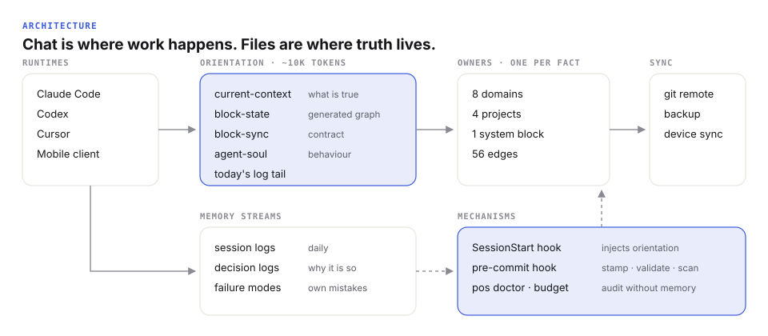
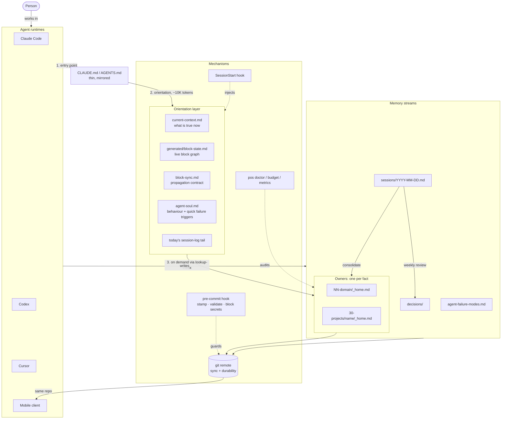
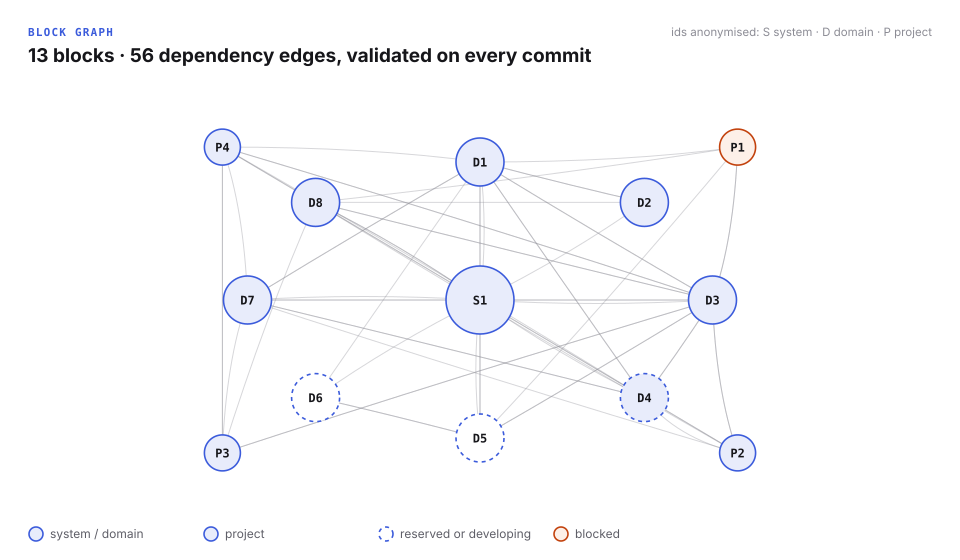

# Architecture

**Chat is the execution surface. Files are the source of truth.** The system is plain Markdown in a git repository, so any agent runtime can read it and nothing is locked into one vendor.



The same structure as a Mermaid diagram (renders on GitHub):



## Layers

| Layer | What it holds | Rule |
|---|---|---|
| **Entry** | `CLAUDE.md`, `AGENTS.md` (~50 lines) | Thin pointers only; mirrored so every runtime gets the same rules |
| **Orientation** | current context, generated block graph, sync contract, agent behaviour, today's log tail | Loaded on every cold start; budgeted at 10–20K tokens, hard ceiling 25K |
| **Owners** | one `_home.md` per domain and per project | Exactly one owner per fact; everything else links |
| **Memory streams** | session logs → decision logs → owners | Streams are compacted into long memory at the weekly review |
| **Calibration** | how to work with the person; the assistant's own failure modes | Two separate files; observations promoted only after 2–3 recurrences |
| **Mechanisms** | hooks + the `pos` CLI | Anything broken twice becomes code |
| **Sync** | git remote | The only durability layer; a mobile client reads the same repo |

## The block graph

A **block** is a domain (self, learning, projects, …), a project, or the system itself. `00-meta/block-registry.json` declares each block, its owner file and which blocks it reads:

```json
{ "id": "projects", "kind": "domain", "owner": "30-projects/_home.md",
  "depends_on": ["self", "example-project"] }
```



Owners carry flat frontmatter (`title`, `status`, `updated`, `sync_registry`). From that, `pos check` derives a generated read model — never edited by hand — and validates:

- every owner exists and has the required frontmatter;
- every dependency points at a known block, and no block depends on itself;
- every domain is reachable from the root dashboard;
- every live/active/blocked project appears in current context (an agent must not be able to miss it).

On commit, the hook also reports **reverse dependencies** of the changed owners — the blocks whose meaning may need updating. That list is the hand-off point from deterministic code to agent judgment.

## Why plain files and git

- **Portable across runtimes.** Three different agent tools and a phone read the same memory without an API in between.
- **Auditable.** Every decision, correction and state change is a diff with a date.
- **Durable.** A clone is a full backup; there is no database to lose.
- **Cheap.** No hosting, no vector store. Semantic search is a deliberate *future* step with a density trigger (folders over ~30 notes), not a default.

## The `pos` CLI

Python, standard library only: ~1,100 lines of code, 34 tests including end-to-end runs through the real git hook.

| Command | Replaces |
|---|---|
| `pos init` | hand-copying a template vault |
| `pos check [--write --stamp --staged]` | the original sync script + manual date stamping |
| `pos doctor` | the mechanical half of a monthly LLM-driven checklist |
| `pos budget` | a "keep cold start under 25K" rule nobody measured |
| `pos metrics` | hand-counted numbers in status reports (aggregate-only, safe to publish) |
| `pos scan` | trusting myself not to paste private data into a public repo |
