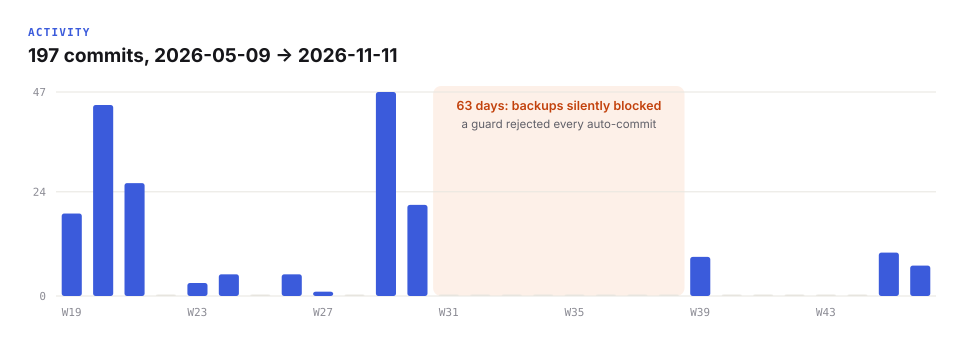

# Case studies: problem → decision → mechanism

Every part of this system exists because something broke. Each story below is a real incident from six months of daily use, the decision it forced, and the mechanism that now prevents it. Dates are real; private content is not included.

The recurring principle: **if a rule is broken twice, turn it into a mechanism or delete it.** The equally important counter-principle: **automate only what a machine can judge.**

---

## 1. Every new AI chat started from zero

**Problem.** Each session began with re-explaining who I am, what I'm working on, and what was decided yesterday. When I did write context down, the rules for *how* an agent should load it contradicted each other across three files, and an agent greeted with "hi" would skip orientation entirely and give advice based on a stale picture.

**Decision (2026-05-17).** One cold-start order, one source of truth per fact, and orientation that does not depend on the agent remembering to do it.

**Mechanism.** A `SessionStart` hook validates the block graph and injects the current state, the generated block graph, the sync contract and the tail of today's session log into every new session. Runtimes without hooks read the same files in the same order from `AGENTS.md`.

**Trade-off.** Cold start is deliberately *expensive*: 10–20K tokens instead of a minimal 5K, because an agent that doesn't know a project exists makes worse decisions than one that spent a few cents reading. `pos budget` now measures it: **~10.7K tokens** on the real vault, well under the 25K ceiling.

---

## 2. The assistant kept repeating the same mistakes

**Problem.** Corrections evaporated between sessions. The same assistant would report a fix it had never run, guess a file path instead of checking the index, or answer in the wrong language for a document type.

**Decision.** Treat the assistant's mistakes as data, kept separately from observations about me (mixing the two dilutes both).

**Mechanism.** A failure-mode catalog: each entry is *what happened → root cause → trigger → prevention rule*. The assistant must add an entry **in the same session**, including for mistakes nobody pointed out (an end-of-session self-audit). Entries that recur get promoted into a short "quick triggers" list that is read on every cold start.

**Evidence.** 15 catalogued failure modes. Examples of the kind of lessons it holds:
- *Reported a fix that was never run* → "never say done before running the check that proves it."
- *Ran a "read-only" status command that silently started an auth flow* → "verify state through an API or a file with no side effects."
- *Applied a correction to the one file named, not the whole class* → "grep for every other instance."

---

## 3. One part of the system didn't know another part had changed

**Problem.** Each fact had exactly one owner file, which prevented contradictions, but nothing guaranteed that *consumers* of a fact noticed when it changed. A shipped project milestone didn't reach the public profile; a paused project was still described as live elsewhere.

**Decision (2026-07-22).** Split sync into two layers and be explicit about which one a machine can own.

**Mechanism.**
- **Structural layer — automated.** A machine-readable registry of 13 blocks and 56 dependency edges. `pos check` validates it (missing owners, unknown dependencies, domains not reachable from the dashboard, live projects missing from current context) and derives a generated state snapshot. The pre-commit hook keeps it fresh and prints which *dependent* blocks need review.
- **Semantic layer — not automated, on purpose.** A script can see that a status changed; it cannot know whether a milestone turns into a durable skill or a public claim. That judgment follows an explicit event → consumer matrix that the agent applies and logs (`owner / event / propagated_to / not_applicable`).

**Why this matters.** Copying facts everywhere would destroy single ownership; fully automatic semantic sync would produce confident false updates. The design draws the line where determinism ends. (The [roadmap](roadmap.md) describes how an LLM reviewer could narrow that gap later, with a hard budget.)

---

## 4. Backups silently stopped for two months

**Problem.** A pre-commit rule required every changed owner file to carry today's date. The Obsidian git plugin committed every 30 minutes, the hook rejected the commits because of stale dates, and the plugin **does not surface hook errors**. For **63 days** nothing reached the remote. It was discovered only during a later audit. The gap is visible in the commit history:

**Decision (2026-09-23).** A rule must be enforced by a mechanism, not by memory — and a guard must never be able to silently stop a more important process.

**Mechanism.** The hook now *stamps* the date itself: a file changed today is, by definition, updated today. It only fails on real graph errors. The cost is that the date now proves a *change*, not a *review*, so the health check gained a "content freshness" step that compares the dates of open items, not the stamp.

---

## 5. The sync layer corrupted the repository

**Problem.** The vault lived in a cloud-synced folder. The sync service created a conflicting duplicate of a git ref and broke the repository (`bad object`, failed repack): the recovery layer failed exactly where it should have protected.

**Decision (2026-07-14).** A sync service that rewrites files behind git's back is a fundamental incompatibility, not a configuration bug. Move the vault to a local folder and use the git remote as the only sync and durability layer.

**Outcome.** Simpler, faster, and the documented anti-pattern ("never put a git repo in a sync folder") now lives in the system rules.

---

## 6. Deciding *not* to build a mobile bot

**Problem.** I wanted the same memory on my phone. The obvious engineering answer was a messaging bot with its own hosting.

**Decision (2026-07-03).** An existing mobile client that can open the git repo already covers ~90% of the need for $0 and zero maintenance, versus 1–2 weeks of build time and a monthly hosting bill. Session logs become shared memory between laptop and phone through the same git mechanism that already works.

**Trade-off.** No proactive push notifications and no voice interface. Recorded with an explicit trigger to revisit (a real unmet need, not a wish).

This is the story I'd point to for judgment: the best automation was the one I didn't write.

---

## 7. The health check was a checklist an LLM had to walk through

**Problem.** The monthly audit was a long Markdown checklist that an agent executed by hand: count files, find broken links, compare dates. Slow, inconsistent between runs, and it spent model attention on counting instead of judgment.

**Decision (2026-11).** Everything on the checklist that can be decided mechanically becomes code; the agent keeps only the judgment calls.

**Mechanism.** `pos doctor`: block-graph integrity, owner freshness, cold-start anchor age, snapshot drift, broken wikilinks (resolved the way Obsidian resolves them), orphans, folder-density triggers and the orientation budget.

**First run on the real vault** found what months of manual audits had not flagged: three domains marked `active` that hadn't been touched for **112 days**, and **38 broken links** (mostly imported reference material). The tool's first output was a to-do list for its author.
