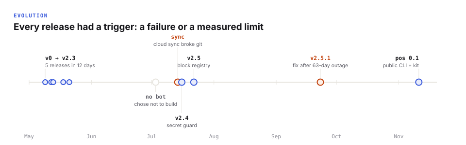

# Evolution

Six months, nine releases. Each version was triggered by a failure or a measured limit, not by a feature wish. Full reasoning for each step lives in a dated decision log in the private vault; summaries are in [case studies](case-studies.md).

| Version | Date | Trigger | What changed |
|---|---|---|---|
| v0 | 2026-05-09 | Start | A focused learning vault: notes plus an instruction file for one agent |
| v1 | 2026-05-12 | Learning was only one part of life the agent needed to know | Personal OS skeleton: a person, numbered domains, a system layer |
| v2 | 2026-05-13 | One giant instruction file, different per tool | Thin mirrored entry points; behaviour (`agent-soul`) split from protocols (`system-rules`); decision logs; health-check checklist |
| v2.1 | 2026-05-13 | Growth would outrun the structure | Scaling foundations: tools inventory, automation register, scaling strategy with density triggers, protocols, inbox |
| — | 2026-05-15 | Placeholder domains confused agents | Dashboard split into active / developing / reserved domains; agent behaviour file trimmed |
| v2.2 | 2026-05-18 | "Self-aware but not autonomous": the system documented its failure modes but relied on the agent remembering protocols | `SessionStart` hook replaces manual cold start; timestamp-only autosave replaced by content written by the agent; end-of-session self-audit |
| v2.3 | 2026-05-21 | Duplication and orphans after fast growth | Orphan removal, one owner per fact enforced, frontmatter on every owner |
| — | 2026-07-03 | Need phone access | Decided **against** building a bot; existing client over the same repo |
| — | 2026-07-14 | Cloud sync corrupted git | Vault moved local; git remote is the only sync layer |
| v2.4 | 2026-07-16 | Drift after the move; a public claim out of sync with reality | Secret guard in pre-commit; report-only health check (no silent auto-fixes); sources of truth rebuilt |
| v2.5 | 2026-07-22 | Blocks didn't know other blocks changed | Machine-readable block registry, generated global state, semantic propagation contract |
| v2.5.1 | 2026-09-23 | 63-day silent backup outage | Pre-commit stamps freshness itself instead of blocking |
| **pos 0.1** | 2026-11-11 | The system worked for one person and one machine | Extracted into this public repo: `pos` CLI, deterministic doctor, budget meter, aggregate metrics, privacy gate, starter kit, CI |

## What stayed constant

- Plain Markdown + git as the substrate.
- One owner per fact.
- Changes to the architecture require a written decision.
- Plans change at the weekly review, not mid-week.

## What I would do differently

- **Measure from day one.** Rules like the token budget existed for months before anything measured them.
- **Make guards loud.** The backup outage lasted 63 days because a failure was silent. Every guard now fails visibly or fixes the problem itself.
- **Fewer, earlier mechanisms.** Several protocols lived as prose for weeks before becoming hooks; the hooks are what actually held.
