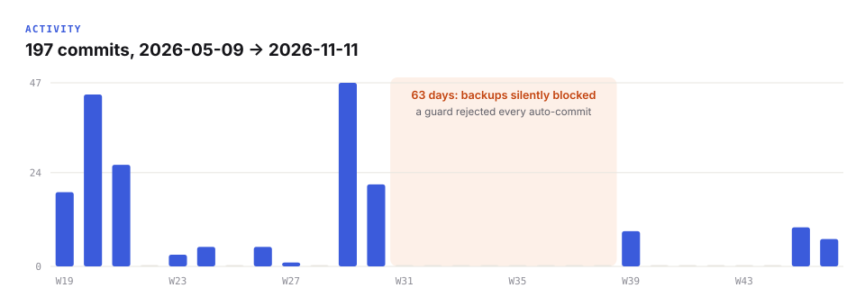
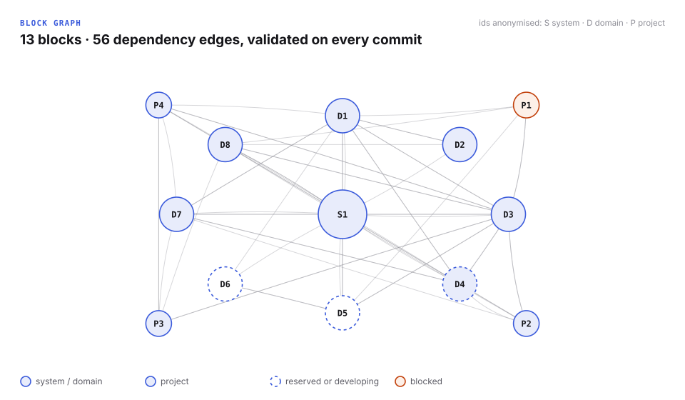
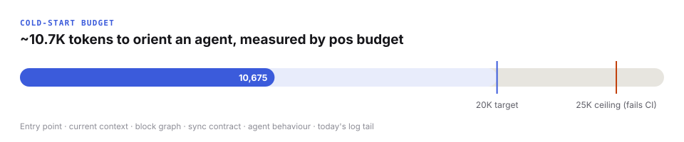

# Metrics

Measured on the private vault on **2026-11-11** with `pos metrics`. The raw output is [`metrics/snapshot.json`](../metrics/snapshot.json): numbers and dates only, by construction (a test plants canary names, paths and content in a fixture vault and fails if any of them reaches the JSON).

## Scale

| Metric | Value | Read |
|---|---|---|
| Notes | 229 | 90 of them are the system layer (`00-meta`), 56 archived |
| Words | 314K | Roughly three books; most of it is session logs and decisions |
| Commits | 197 | 2026-05-09 → 2026-11-11 |
| Active days (commits) | 30 | Work comes in bursts; see the weekly chart |
| Longest commit gap | 63 days | The silent backup outage ([case study 4](case-studies.md#4-backups-silently-stopped-for-two-months)), not inactivity alone |

## Structure

| Metric | Value | Read |
|---|---|---|
| Blocks in the graph | 13 | 8 domains, 4 projects, 1 system block |
| Dependency edges | 56 | Each edge is a "this block reads that block" contract checked on commit |
| Block status | 8 active · 1 live · 1 blocked · 1 developing · 2 reserved | Reserved domains exist so agents know they are intentionally empty |
| Wikilinks | 347 | |
| Notes with outgoing links | 24.5% | Low by design: session logs and archives are streams, not hubs. The owner layer is fully linked (enforced by `pos check`) |
| Broken links | 38 | Mostly in imported reference material. Found by the first `pos doctor` run |
| Orphans (outside streams, archive, templates) | 31 | Next cleanup target |

## Memory

| Metric | Value |
|---|---|
| Session logs | 29 days with a written log |
| Decision logs | 10 (May 4 · July 5 · September 1) |
| Catalogued assistant failure modes | 15 |

## Cost of a cold start

| Item | Tokens (estimate) |
|---|---|
| Entry point | ~1.0K |
| Current context | ~3.3K |
| Generated block graph | ~0.7K |
| Sync contract | ~1.2K |
| Agent behaviour + quick triggers | ~3.2K |
| Today's session-log tail | ~1.2K (grows during the day) |
| **Total** | **~10.7K** (target 20K, ceiling 25K) |

Estimates are local (≈4 characters per token for Latin text, ≈2.5 for Cyrillic) so nothing is sent anywhere to measure them.

## Honest reading

- **One user.** Everything above describes a system used daily by its author. It has not yet been validated by anyone else; that is the first roadmap item.
- **Bursty usage.** Two long pauses (56 and 41 days without project work). The system's value showed in the recovery: a full state rebuild after the second pause took one session, because current context and the decision trail were intact.
- **The audit found real debt.** Three domains marked `active` hadn't changed in 112 days. Status fields drift unless something checks them; now something does.
