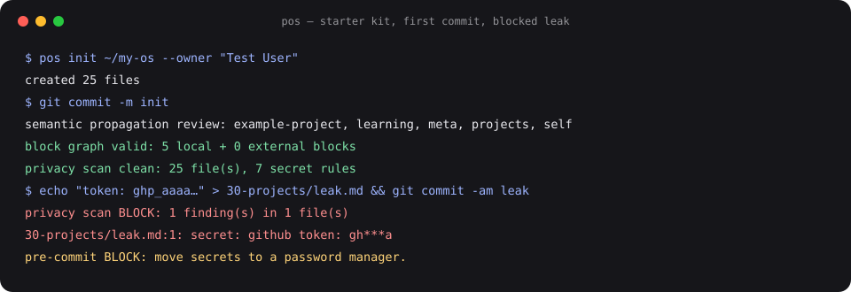

# Privacy model

This repository is derived from a private vault that contains personal, client and financial context. The hard requirement was: **nothing from the vault may leak, ever.** The design assumes I will make mistakes and puts mechanisms between a mistake and a publish.

## Threat model

| Leak path | Example | Control |
|---|---|---|
| Copying a file and forgetting what is in it | a template that still mentions a client | **Allowlist build.** Nothing is copied from the vault except reviewed code. Every Markdown file here was written fresh for a generic reader |
| Git history | a private file committed, then deleted | **Fresh repository.** No shared history with the vault; it was never a fork or a filtered clone |
| Names, places, private project names in prose | a case study that names a person | **Private denylist** checked by `pos scan` in the pre-commit hook. The denylist lives outside the repo, so the list of things not to publish is itself never published |
| Secrets | an API key pasted into an example | Secret-shaped patterns (API keys, GitHub/Slack/AWS tokens, JWTs, private keys) blocked in pre-commit and in CI |
| Identifying paths and e-mails | `/Users/<name>/...`, a personal address | Home-path and e-mail rules (with an allowlist for `example.com` and no-reply addresses) |
| Metrics that reveal content | a "top notes" list | **Aggregate-only metrics**: counts, dates, week buckets and top-level area names. A canary test fails if a planted name, path, block id or word reaches the output |
| Staged vs. working tree mismatch | a secret cleaned in the editor but still staged | The hook scans the **git index**, not the working tree; there is a test for exactly this |

## Layers, in order

1. **Write, don't copy.** Allowlist by construction.
2. **Pre-commit gate** with the private denylist (`.githooks/pre-commit` → `pos scan --staged`).
3. **CI gate** with pattern rules (the denylist cannot run in CI because it is private — by design).
4. **Human review** of the full diff before the first push.

## In the vault itself

The same tool protects the private vault: its pre-commit hook blocks secret-shaped tokens and anything under `private/` (git-ignored), with `--patterns-only`, because inside your own vault your own names are expected.
